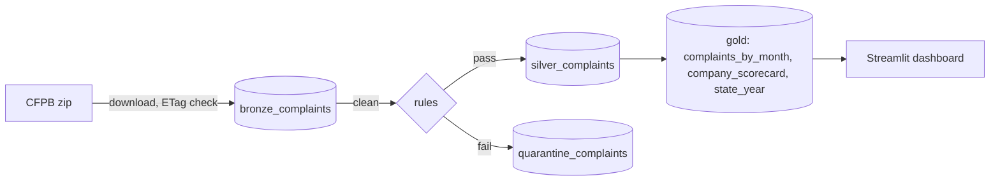

# CFPB complaints lakehouse

A lakehouse built on the Consumer Financial Protection Bureau's public database of consumer complaints about banks, lenders and credit bureaus. It loads the whole file, cleans it, keeps it current when complaints change after filing, and ends in a small set of tables behind a dashboard.

It answers questions like "which companies with at least 1,000 complaints most often give the customer relief" or "how many credit reporting complaints came in each month" from tables of a few thousand rows, without touching the 19 million raw ones.

## What is in it

| | |
|---|---|
| Source | [CFPB Consumer Complaint Database](https://www.consumerfinance.gov/data-research/consumer-complaints/), one 366 MB zip, refreshed daily |
| Rows loaded | 19,112,942 (5.8 GB of CSV) |
| Rows in silver | 19,105,892 |
| Rows quarantined | 7,050, all with "sent to company" earlier than "received" |
| Range | December 2011 to November 2026, 21 products, 8,211 companies |
| Full run | about 1 minute 45 seconds on an 8-core laptop, 1.6 GB of Delta tables |
| Tests | 10, plus a two-step incremental run in GitHub Actions |

## How it works



1. **Bronze** (`lakehouse/bronze.py`). Reads the CSV with PySpark and appends it to a Delta table as it came, every value still text, with the batch id, load time and source file. Column names become snake_case because Delta does not allow spaces. A batch id that is already loaded is skipped, so running twice loads nothing twice.
2. **Silver** (`lakehouse/silver.py`). Trims text, turns empty strings into nulls, casts ids, dates and the on-time flag, and applies the quality rules. Rows that fail a rule go to `quarantine_complaints` with the reason, and the rest are merged into `silver_complaints`.
3. **Gold** (`lakehouse/gold.py`). Three small Delta tables rebuilt from silver: complaints per month and product, a scorecard per company (complaints, share answered on time, share ending in relief), and complaints per state and year.
4. **Dashboard** (`app/dashboard.py`). Streamlit, reading the gold tables.

### Silver is an upsert, because complaints change after filing

The CFPB updates a complaint when the company responds, so the same complaint id shows up again with a different response. Silver uses a Delta `MERGE` on `complaint_id`. Every row carries a hash of its fields, and the merge updates a row only when the hash differs, so a rerun on an unchanged file writes nothing:

```
first run   silver: 19105892 inserted, 0 updated
second run  silver: 0 inserted, 0 updated
```

The GitHub Actions run loads a 318-row sample, then a second file with 40 changed responses and 319 new complaints, and checks for exactly `319 inserted, 40 updated`.

### Quality rules

A complaint is quarantined, not dropped, when:

- the id is not a number (`complaint_id_not_numeric`)
- the received date does not parse (`date_received_invalid`) or is in the future (`date_received_in_future`)
- the company was sent the complaint before it was received (`sent_before_received`)
- the on-time flag is anything but Yes or No (`timely_response_unknown`)

On the full file only the date order fails, 7,050 rows. Quarantine is written per batch, so a rerun replaces its own rows and never doubles them. A missing on-time flag is allowed and stays null.

Not handled: the CFPB does not publish deletions, so a complaint it removes stays in silver.

## Run it

You need [devenv](https://devenv.sh), which brings Java 17, Python and uv.

```sh
devenv shell
uv run pytest                                   # tests, on a tiny Spark session
uv run python -m lakehouse.run                  # download, bronze, silver, gold
uv run python -m streamlit run app/dashboard.py # dashboard at localhost:8501
```

`lakehouse.run --csv sample/complaints_v1.csv --batch-id v1` runs the same steps on the sample instead of downloading. All paths come from `LAKE_PROJECT_DIR` and `LAKE_DATA_DIR`, which devenv sets.
